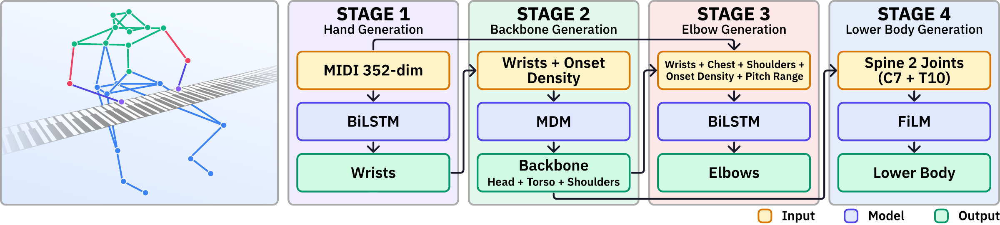

<div align="center">

# Pianoid

**3D pianist body motion generation from MIDI**

[Joonhyung Bae](https://github.com/joonhyungbae) · Juhan Nam<br>
Graduate School of Culture Technology, KAIST

[](https://ismir2026program.ismir.net/poster_287.html)
[](LICENSE)
[](environment.yml)

[Project page](https://joonhyungbae.github.io/pianoid/) ·
[Paper](https://joonhyungbae.github.io/pianoid/assets/pianoid_ismir2026.pdf) ·
[Video](https://youtu.be/GaFwqai4PsE) ·
[ISMIR page](https://ismir2026program.ismir.net/poster_287.html) ·
[Checkpoints](https://github.com/joonhyungbae/pianoid/releases/tag/v1.0.0)

<a href="https://youtu.be/GaFwqai4PsE"></a>

</div>

Pianoid is a four-stage pipeline that generates 3D, 26-joint pianist motion from symbolic MIDI. The body partition and the placement of diffusion come from a coupling analysis of the [MOSA](https://zenodo.org/records/11393449) corpus. This repository reproduces the ISMIR 2026 paper.

<p align="center">
  
</p>

<table>
<tr>
<td width="33%" valign="top"><b>Partition from the data</b><br>Shoulders couple more tightly to the torso than to the wrist, so they sit in the backbone rather than in the arm chain.</td>
<td width="33%" valign="top"><b>Diffusion where motion is one-to-many</b><br>Stage 2 diffuses the backbone. Wrists, elbows, and the lower body stay deterministic once conditioned.</td>
<td width="33%" valign="top"><b>Δ₁ next to MPJPE</b><br>MPJPE favors near-static poses. Per-axis expressiveness, aggregated as Δ₁, separates those collapses from expressive motion.</td>
</tr>
</table>

## Results

Headline numbers on the MOSA test split (80 sequences). Expressiveness ratios target 1. Lower is better for MPJPE and Δ₁.

| | MPJPE ↓ | ER-rng | ER-spd | ER-jrk | WZR | AccR | Δ₁ ↓ |
|---|---:|---:|---:|---:|---:|---:|---:|
| Li2018 | **76.7** | 0.66 | 2.92 | 13.1 | 0.17 | 10.5 | 1.36 |
| MDM-adapted | 88.2 | 0.82 | 0.46 | 0.25 | 0.38 | 0.25 | 0.79 |
| EDGE-adapted | 80.2 | 0.71 | 0.51 | **0.69** | 0.27 | **0.54** | 0.46 |
| **Pianoid** | 92.1 | **1.12** | **0.92** | 0.34 | **0.76** | 0.44 | **0.42** |
| Ground truth | — | 1.00 | 1.00 | 1.00 | 1.00 | 1.00 | 0.00 |

`bash inference.sh` regenerates the Pianoid row from the released checkpoints. A fresh A6000 run landed inside the paper's 95% bootstrap CI on every headline metric (10k resamples, seed 42). Stage 2 DDIM sampling is the source of run-to-run variation.

| Paper item | Paper | Reproduced (95% CI) |
|---|---|---|
| MPJPE | 92.1 mm | **92.15 mm** [88.95, 96.54] |
| ER-range | 1.12 | **1.134** [1.082, 1.188] |
| ER-speed | 0.92 | **0.938** [0.868, 1.017] |
| ER-jerk | 0.34 | **0.335** [0.311, 0.361] |
| WZR | 0.76 | **0.762** [0.710, 0.820] |
| AccR | 0.44 | **0.440** [0.413, 0.468] |
| Δ₁ | 0.42 | **0.428** [0.394, 0.465] |

FID 0.028, |ΔJ| 23.95×10⁻⁵, and VelCorr 0.107 are written to `results/full_pipeline.json`. Per-body-part MPJPE matches Table 4 within 1 mm.

## Quickstart

About 30–40 minutes on one GPU once MOSA is on disk. No training.

```bash
git clone https://github.com/joonhyungbae/pianoid.git && cd pianoid

# 1. Environment
bash setup.sh && conda activate pianoid

# 2. MOSA mocap (~40 GB, CC BY 4.0) from Zenodo, then unpack so this exists:
#    MOSA_dataset/yp/<piece>/<performer>/t<trial>/<...>_motion.csv
#    https://zenodo.org/records/11393449
#    14 pieces × 8 performers, 272 sequences

# 3. Preprocess once (~15 min)
python scripts/preprocess/build_splits.py
python src/stage1/s05_preprocess_motion.py
python src/stage1/s12_precompute_training_data.py --onset_window 0.5 --output_dir MOSA_dataset/training_cache_W05
python src/stage1/s12_precompute_training_data.py --onset_window 1.0 --output_dir MOSA_dataset/training_cache_W10
python src/stage1/s12_precompute_training_data.py --onset_window 2.0 --output_dir MOSA_dataset/training_cache_B

# 4. Released checkpoints (~188 MB)
bash scripts/download_checkpoints.sh

# 5. Paper numbers (~10–20 min, one GPU)
bash inference.sh
```

Training from scratch is `bash train.sh` in place of step 4 (about 3–5 days on one GPU). Step 5 is unchanged.

## Pipeline

| Stage | From → to | Model | Checkpoint |
|---|---|---|---|
| 1 | MIDI → wrists (2) | BiLSTM, Z-axis log-ratio loss | `checkpoints/release/stage1_wrist/model.pt` |
| 2 | wrists → backbone (10: head, torso, shoulders) | MDM + z-score, DDIM-45 | `checkpoints/release/stage2_backbone/model.pt` |
| 3 | wrists + chest + shoulders → elbows (2) | BiLSTM, shoulder-relative | `checkpoints/release/stage3_elbow/model.pt` |
| 4 | spine → lower body (10) | FiLM, spine only | `checkpoints/release/stage4_lower/model.pt` |

[inference.sh](inference.sh) calls [src/pipeline/full_pipeline.py](src/pipeline/full_pipeline.py). Per-stage trainers live in [scripts/train/](scripts/train/) and are orchestrated by [train.sh](train.sh).

## Setup

```bash
bash setup.sh            # conda env `pianoid`, Python 3.11
conda activate pianoid
```

ARIA is optional. The released model and the headline numbers do not use it. It is required only for the Stage 4 `FiLM + ARIA` row in Table 3(D):

```bash
INSTALL_ARIA=1 bash setup.sh
```

## Data and checkpoints

MOSA is 26-joint mocap at 60 fps, eight performers (`yp01`–`yp08`), 272 sequences, Henle grades 3–9. MIDI is reconstructed from note annotations, so per-note velocity is unavailable. The paper split is 158 / 34 / 80:

- train: `yp01`–`yp05`, excluding `yp04`/`yp05` on `{be1, tc1}`
- val: `yp06`
- test: `yp07` + `yp08` + `yp04`/`yp05` on `{be1, tc1}`

After preprocessing, the tree is `MOSA_dataset/{splits.json, yp/, preprocessed/, training_cache_W05/, training_cache_W10/, training_cache_B/}`.

Checkpoints are the [v1.0.0 release](https://github.com/joonhyungbae/pianoid/releases/tag/v1.0.0) zip. [scripts/download_checkpoints.sh](scripts/download_checkpoints.sh) unpacks them under `checkpoints/release/` and checks SHA256.

```
checkpoints/release/
├── stage1_wrist/      model.pt   139 MB    BiLSTM h512 l6, v3 loss
├── stage2_backbone/   model.pt    30 MB    MDM z-score h256 l8, DDIM 45
├── stage3_elbow/      model.pt    35 MB    BiLSTM h256 l6, predicted-train
├── stage4_lower/      model.pt   0.25 MB   FiLM h128 l4, spine-only
└── SHA256SUMS.txt
```

Each `model.pt` loads with `torch.load(..., weights_only=False)` and stores `model_state_dict`, `config`, `val_mpjpe_mm`, and `epoch`. Stage 2 also stores `norm_stats`. Fresh runs can be packed with `python src/project_utils/release_checkpoints.py --mode copy`.

## What else the paper reports

Only Pianoid's checkpoints are distributed. Baseline code (Li2018, MDM-adapted, EDGE-adapted, Single-Stage MDM+zs, BiLSTM-backbone) is in this repo and can be trained end to end.

`bash inference.sh` runs three blocks:

1. Section 3 analysis (F1–F6, Table 1) via `experiments/analysis/`.
2. The full pipeline, writing the Table 2 Pianoid row to `results/full_pipeline.json`.
3. Table 4 per-body-part MPJPE via `experiments/benchmark/compute_bodypart_metrics.py`.

`bash train.sh` trains Stages 1–4 and then the Table 2 baselines. A following `bash inference.sh` scores the new checkpoints.

<details>
<summary>Baselines, ablations, and the file map</summary>

<br>

| Paper item | Command | Output |
|---|---|---|
| Table 2 baselines | [`bash scripts/baselines.sh all`](scripts/baselines.sh), then [`python experiments/benchmark/evaluate_all.py`](experiments/benchmark/evaluate_all.py) | `experiments/benchmark/unified_comparison.json` |
| Table 3(A) Stage 2 | [`bash scripts/ablation/stage2_monolithic.sh`](scripts/ablation/stage2_monolithic.sh), [`bash scripts/train/stage2.sh sweep`](scripts/train/stage2.sh) | `results/stage2_*.json` |
| Table 3(B) Stage 3 | [`bash scripts/ablation/stage3_rows.sh`](scripts/ablation/stage3_rows.sh) | `results/stage3_*.json` |
| Table 3(C) Stage 1 losses | [`bash scripts/ablation/stage1_v1v2.sh`](scripts/ablation/stage1_v1v2.sh), [`bash scripts/ablation/stage1_loss_sweep.sh`](scripts/ablation/stage1_loss_sweep.sh) | `results/stage1_*.json` |
| Table 3(D) Stage 4 | [`bash scripts/train/stage4.sh`](scripts/train/stage4.sh) | `results/stage4_ablation.json` |
| Stage 3 multi-seed CIs | [`bash scripts/ablation/stage3_multiseed.sh`](scripts/ablation/stage3_multiseed.sh) | `results/stage3_multiseed.json` |
| Section 3 analysis | scripts under `experiments/analysis/` | `results/music_body_analysis.json`, `results/expressiveness_analysis.json`, `results/delta1_axis_correlation_and_perf.json` |
| Bootstrap CIs for the headline row | [`src/evaluation/compute_full_pipeline_er.py`](src/evaluation/compute_full_pipeline_er.py) | `results/full_pipeline_er.json` |

```
pianoid/
├── inference.sh                 paper numbers, no training
├── train.sh                     from-scratch cascade
├── setup.sh
├── src/
│   ├── stage{1,2,3,4}/          training and inference
│   ├── pipeline/                full_pipeline.py
│   ├── models/  data/  evaluation/  diffusion_lib/
│   └── project_utils/
├── scripts/
│   ├── train/  baselines.sh  ablation/  preprocess/
│   └── download_checkpoints.sh
├── experiments/                 analysis, benchmark, figures
├── vendor/                      MDM, EDGE, aria (original licenses)
├── MOSA_dataset/                not tracked
├── checkpoints/                 not tracked
└── results/                     not tracked
```

</details>

## Citation

```bibtex
@inproceedings{bae2026pianoid,
  title     = {Pianoid: 3{D} Pianist Body Motion Generation from {MIDI}},
  author    = {Bae, Joonhyung and Nam, Juhan},
  booktitle = {Proceedings of the 27th International Society for
               Music Information Retrieval Conference (ISMIR)},
  address   = {Abu Dhabi, UAE},
  year      = {2026},
}
```

## Acknowledgments

Built on [MDM](https://github.com/GuyTevet/motion-diffusion-model) (Tevet et al., ICLR 2023) and the [MOSA dataset](https://zenodo.org/records/11393449).

## License

Code is released under the [MIT License](LICENSE). Code under [`vendor/`](vendor/) keeps its own license (MDM, EDGE, aria). MOSA is CC BY 4.0 and is not redistributed here.
